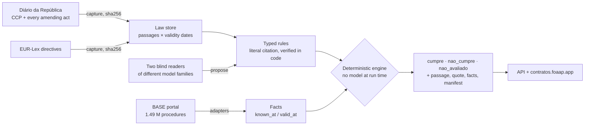

<div align="center">

# ccp-engine

**Do Portugal's public contracts follow the law? A deterministic engine that checks every procedure against the
Código dos Contratos Públicos, and cites the article it applied.**

[**Live: contratos.foaap.app**](https://contratos.foaap.app) &nbsp;·&nbsp; [API](https://contratos.foaap.app/v1/estatisticas) &nbsp;·&nbsp; [How a verdict is made](#how-a-verdict-is-made) &nbsp;·&nbsp; [Run it](#run-it)


</div>

---

Portugal publishes every public procurement procedure on the BASE portal. Nobody checks them against the law at scale.
This engine does: it reads the **Código dos Contratos Públicos as data**, every article, number and alínea with the
dates each wording was in force, and applies typed rules to the facts of each procedure. The result is a verdict
of `cumpre` (complies), `nao_cumpre` (does not comply) or `nao_avaliado` (cannot say, and why). It never guesses.

| | |
|---|---|
| Procedures read from BASE | **1,487,586** |
| Verdicts that comply / do not | **32,578 / 240** |
| Diplomas in the law store (CCP, amending acts, EU directives) | **381** |
| Passages, each with every wording it has had | **40,088** |
| Validity records (which text was in force when) | **31,090** |
| Typed rules, each citing its passage literally | **101** |
| Recorded design decisions | **95** (`schemas/DECISIONS.md`) |

Every page loads in under half a second; the full report of any verdict is one click away.

## A real verdict

`GET /v1/veredictos?resultado=nao_cumpre&limite=1`, unedited:

```json
{
  "procedimento": "proc:base:idproc-10068682",
  "regra": { "id": "regra:ccp:limiar-consulta-previa-obras@v1", "tipo": "limiar", "estado": "settled" },
  "resultado": "nao_cumpre",
  "detalhe": "preco_base=350000 lt 150000; início entre 2025-05-04 e 2026-05-04 (decisão de contratar não datada): o mesmo resultado em 2 datas",
  "passagem": "ccp:art19.c",
  "versao": "2018-01-01",
  "citacao": "c) Consulta prévia, com convite a pelo menos três entidades, quando o valor do contrato for inferior a (euro) 150 000;",
  "factos_usados": ["…:preco_base:base-contratos", "…:tipo_contrato:base-contratos", "…:tipo_procedimento:base-contratos"],
  "valido_em": "2026-05-05",
  "conhecido_em": "2026-11-06T20:14:46Z",
  "manifesto": { "lei": "lei:ccp@2026-05-04", "commit": "d1dfa2b32", "motor": "ccp-engine-0.1", "registo": "d0b90622…" }
}
```

A €350,000 public-works contract awarded by *consulta prévia*, a procedure the CCP allows only below €150,000. The
verdict names the passage (art. 19.º c), the wording in force on that date (since 2018-01-01), the literal quote,
the three facts it used, and the exact law, code and governance-log state that produced it. The procedure's
start date is unknown, so the engine evaluated both possible dates and returned the result only because they agree.

## How a verdict is made



- **The law in time.** Each article carries every wording it has had and the dates it was in force. A 2019 procedure is
  judged by the 2019 text. When the Diário da República's own pages disagree, the engine keeps every version and
  reports the conflict instead of picking one.
- **Models propose, code decides.** Readers (AMALIA, the Portuguese public-sector model, and an open-weights reader of
  another family) propose how a passage decomposes into a rule. A rule is `settled` only when a blind reader of the
  other family replicates it, and code verifies every quote against the captured text. At run time no model is called.
- **`nao_avaliado` before a false `cumpre`.** A missing fact, a missing rule, a law passage still being read, or two
  dates that disagree all give `nao_avaliado` with a typed reason.
- **Everything is replayable.** Sources are stored by hash, the governance log is append-only and hash-chained, and
  every verdict names the law version, code commit and log head that produced it.

## Invariants

`verify.py` checks every one of them, with no model and no network; CI runs it, and publishing fails if one fails.

1. **Immutable sources.** Every source byte is stored with its sha256 and capture date; a text whose hash changed is not loaded.
2. **Exact citation.** Every rule, verdict, deadline and event that invokes the law carries a passage id, the literal
   quote and offsets, checked against the captured text.
3. **Verification in code.** `verify.py` re-derives texts, packages, verdicts and published figures.
4. **Models propose, never approve, never write the citation.** Approval requires a person with a reason; proposer,
   reviewer and adjudicator are distinct principals.
5. **Two readers of different families.** One reader alone never settles anything.
6. **`nao_avaliado` before a false `cumpre`.**
7. **Assertions are not facts.** What an entity declared is stored as an assertion and compared with the verdict.
8. **Bitemporal.** Facts and verdicts answer to `known_at` and `valid_at` separately; the law answers to its validity per passage.
9. **Nothing is merged, nothing is overwritten.** A wrong link becomes `stale`; the governance log is append-only.
10. **Public data, passive reading.** Public APIs within their limits; nothing is ever sent to any system.
11. **Natural persons** are evaluated but never published by name.
12. **Product rules are not legal content.** Readings of the law belong to the readers, with code-verified citations.

## Run it

```bash
python3.12 -m venv .venv && .venv/bin/pip install -r requirements.txt
.venv/bin/python -I verify.py                         # the gate: every invariant, no model, no network
.venv/bin/python -m pytest tests --ignore=tests/fill  # unit tests
.venv/bin/python -I tools/serve.py --port 5341        # the API over the law and rules in this repo
```

## Layout

```
engine/       store (append-only, bitemporal), rules as data, evaluate, entities, manifest, governance
law/          norms, passages and validity records: the CCP and its amending acts, in time
rules/        rule packages; the replay of the governance log (never edited by hand)
governance/   principals and the append-only, hash-chained event log
verify.py     the gate: schemas, invariants, broken fixtures that must fail
schemas/      one JSON schema per object; DECISIONS.md (95 decisions); TRACEABILITY.md
adapters/     BASE, Diário da República and EUR-Lex readers
db/           Postgres store, the daily run, the public API
readers/      the blind readers that propose rule readings
training/     fine-tuning runs of the Portuguese reader, each with its frozen sets
web/          contratos.foaap.app (React + Vite)
tools/        capture, build the law, refresh, measure, package
```

Built by [Paulo Villalobos](https://github.com/paulovillalobos) · [FOAAP](https://tecnologia.foaap.app/), Porto.
